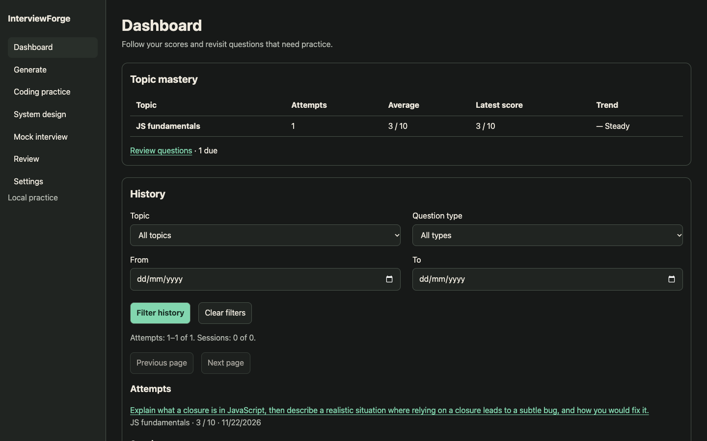
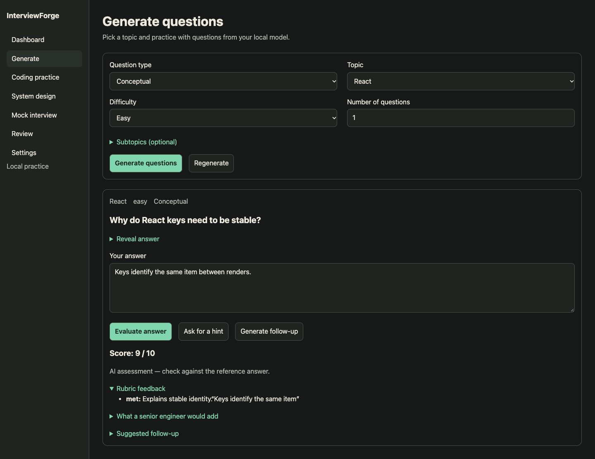
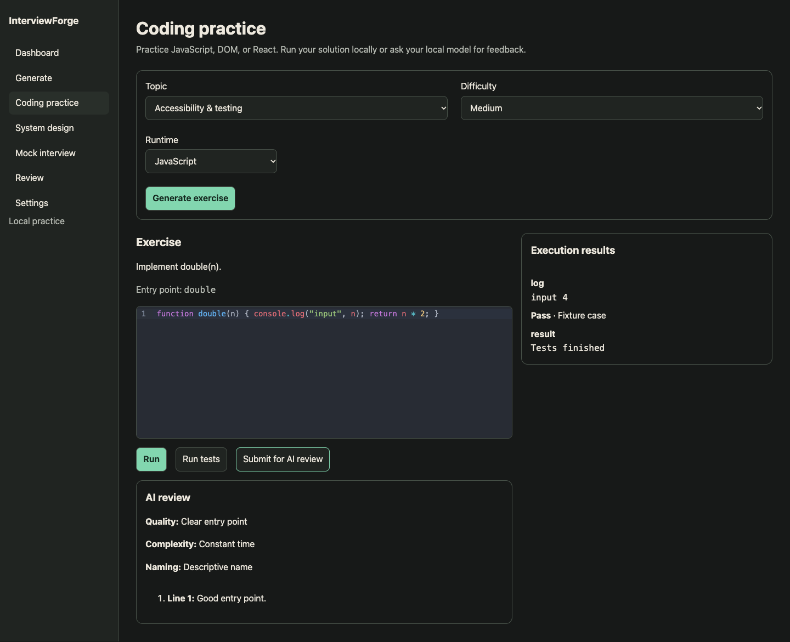
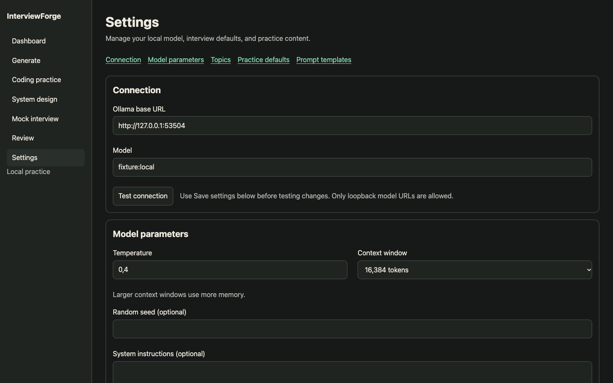

# InterviewForge

InterviewForge is a local interview-practice app for frontend and JavaScript engineers. React and CodeMirror run in the browser, Fastify talks to Ollama, and SQLite stores your work. No account, cloud editor, or API key is needed.

## Start locally

Install Node.js 20.19 or later, pnpm 10, and [Ollama](https://ollama.com/download). Start Ollama if it is not already running:

```sh
ollama serve
```

In another terminal, download a model once, then build and start InterviewForge:

```sh
ollama pull qwen3.5:9b
pnpm install --frozen-lockfile
pnpm seed
pnpm build
pnpm start
```

Open `http://localhost:3000`. After setup and the first model download, practice can run offline. If port 3000 is in use, run `PORT=3001 pnpm start` instead and open that port. For development, `pnpm dev` starts Vite at `http://localhost:5173` with an API proxy.

`pnpm seed` adds eight default topics, their subtopics, and two sample questions. It is safe to run again; it does not overwrite existing edits or restore archived topics.

## Practice flows

| Page | What to do |
| --- | --- |
| Dashboard | See topic mastery, scores, and filtered attempt and session history. |
| Generate | Pick a topic, subtopics, difficulty, and question type. Reveal the stored answer, take hints, or submit your answer for rubric-based feedback. |
| Coding practice | Pick JavaScript, DOM, or React. Edit in the bundled CodeMirror editor, run code and hidden tests, then request a review with line comments. |
| System design | Pick or generate a scenario. Submit Markdown and fenced Mermaid diagrams, then iterate on structured feedback. |
| Mock interview | Choose 15, 30, or 60 minutes, set weights, take hints or skip questions, and open the saved report. |
| Applications | Manage job applications, generate tailored cover letters with model selection, and learn from successful examples. |
| Review | Revisit weak questions first. Scores of 7 or higher advance the review interval. |
| Settings | Check Ollama, choose installed models, set defaults, manage topics, and edit or reset templates. |

### Prepare for a Sipwise frontend interview

In **Mock interview**, enter `Sipwise` as the company and `Frontend Developer` as the role. Paste the job description or notes under **Company info**. To practice situational questions, choose a text-based PDF under **CV PDF** and leave **Ask situational questions about my CV** checked. InterviewForge uses the supplied context for question generation; it does not look up the company or verify claims in a CV.

The PDF itself stays in the browser. Extracted text is saved with the mock session and sent to the local model. Scanned and password-protected PDFs are not supported; export a text-based PDF without password protection. Avoid including details you do not want stored in SQLite or local model request logs.

### Change models and settings

Pull a different model with `ollama pull <model>`. In **Settings → Connection**, save your loopback Ollama URL, then select **Test connection** and choose an installed model. Save again to apply the model selection. For slower machines, use a smaller installed model or the 16,384-token context.

| Section | Options |
| --- | --- |
| Connection | Ollama loopback URL and model name. Default: `http://localhost:11434`, `qwen3.5:9b`. |
| Model parameters | Temperature, context window, optional seed, and system instructions. |
| Topics | Add, rename, adjust weights, or archive topics and subtopics. History retains its topic context. |
| Practice defaults | Difficulty mix, timer, hints, and points per hint. |
| Prompt templates | Editable templates with required substitution slots and a reset action. |

## Local storage and limits

- SQLite and raw model request/response logs live in `~/.interviewforge`; use `INTERVIEWFORGE_DATA_DIR` to choose another directory. Logs may contain answers, code, company notes, and extracted CV text. Back up this directory only to a location you trust.
- The app binds to loopback. The browser uses the app's own API, never Ollama directly. Do not expose this local instance through a public reverse proxy.
- Requests explicitly select Ollama's local model source. Use an Ollama release that supports the `:local` source suffix. For defense in depth, disable cloud features in your Ollama configuration or start it with `OLLAMA_NO_CLOUD=1 ollama serve`.
- JavaScript runs in an isolated browser worker with a 3-second run limit. DOM and React run in a hidden sandboxed iframe with a real browser document. Iframe removal is best-effort: a synchronous loop can block the tab. Use practice code you trust. Hidden tests run locally and are not shown in the editor, but their code is delivered to the browser.
- Feedback comes from the configured model. Check its explanations against the saved reference answers.

## Checks

```sh
pnpm typecheck
pnpm lint
pnpm test
pnpm test:integration
pnpm exec playwright install chromium
pnpm test:e2e
```

`pnpm test` includes a real Ollama generation round trip. If Ollama is unavailable, explicitly opt out with `SKIP_OLLAMA_SMOKE=1 pnpm test`. Set `OLLAMA_SMOKE_MODEL` to test a different installed model. Browser tests use an isolated, deterministic local fixture, not your Ollama or SQLite data. Set `PLAYWRIGHT_CHROME=1` to use installed Google Chrome.

## Screenshots

Screenshots use synthetic local fixture data.

| Dashboard | Generate |
| --- | --- |
|  |  |
| **Coding practice** | **Settings** |
|  |  |
